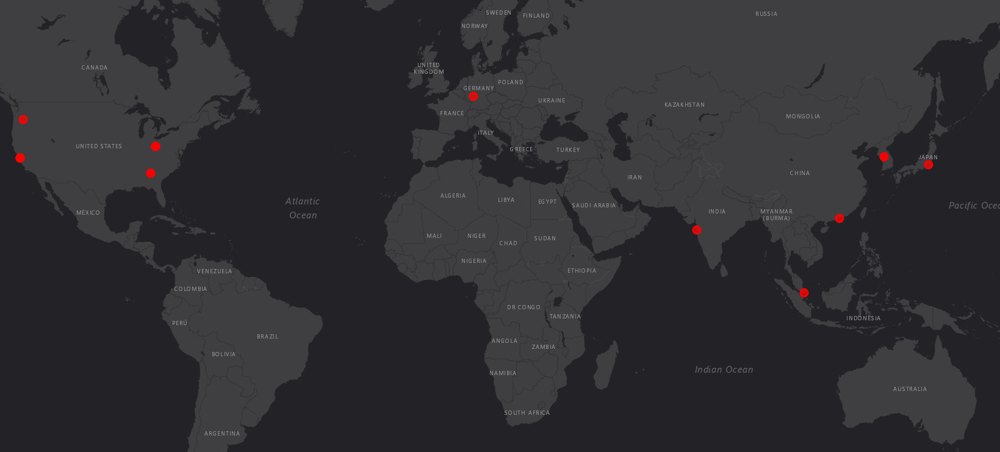

# Web Honeypot Analysis: AI Crawlers & Global Botnets

### Overview & Architecture
This project aimed to analyze automated internet traffic targeting publicly exposed web assets. The mechanism relied on a completely hidden HTML element (`style="display:none;"`) embedded in the main page's code, leading to a fake `/admin/login.php` panel. 

Legitimate web traffic was handled by Nginx, while the hidden link directed bots to a custom Python HTTP listener. This architecture ensured log isolation and provided real-time alerts via a Discord webhook.

### The Honeypot Source Code (Python)
A lightweight HTTP server utilizing `http.server` and `ip-api` for GeoIP tracking.
*Note: The Discord Webhook URL has been sanitized for security.*

```python
import http.server
import socketserver
import urllib.request
import json
from datetime import datetime

DISCORD_WEBHOOK = "<DISCORD_WEBHOOK_URL>"
PORT = 30161

class HoneypotHandler(http.server.SimpleHTTPRequestHandler):
    def log_message(self, format, *args):
        pass # Suppress standard console logs

    def do_GET(self):
        self.handle_request()

    def do_POST(self):
        self.handle_request()

    def handle_request(self):
        ip = self.client_address[0]
        path = self.path
        user_agent = self.headers.get('User-Agent', 'Unknown')
        
        # GeoIP tracking
        try:
            req = urllib.request.urlopen(f"[http://ip-api.com/json/](http://ip-api.com/json/){ip}")
            loc_data = json.loads(req.read().decode())
            country = loc_data.get('country', 'Unknown')
            city = loc_data.get('city', 'Unknown')
        except:
            country, city = "Unknown", "Unknown"

        msg = (f"🚨 **HONEYPOT ALERT!** 🚨\n"
               f"**IP:** `{ip}` ({city}, {country})\n"
               f"**Target:** `{path}`\n"
               f"**User-Agent:** `{user_agent}`")
        
        # Discord Webhook integration
        try:
            req_discord = urllib.request.Request(
                DISCORD_WEBHOOK, 
                data=json.dumps({"content": msg}).encode('utf-8'), 
                headers={'Content-Type': 'application/json', 'User-Agent': 'Mozilla/5.0'}
            )
            urllib.request.urlopen(req_discord)
        except Exception:
            pass 

        # Fake response for the attacker
        self.send_response(200)
        self.send_header("Content-type", "text/html")
        self.end_headers()
        fake_page = "<html><body style='background: black; color: #0f0;'><h1>Access Denied - This incident will be reported.</h1></body></html>"
        self.wfile.write(fake_page.encode())

with socketserver.TCPServer(("", PORT), HoneypotHandler) as httpd:
    httpd.serve_forever()
````
### Traffic Analysis (First 72 Hours)
The automated traffic was heavily dominated by two distinct groups:

| Threat Actor Type | Identified User-Agents | Primary Targets | Origin Examples |
|---|---|---|---|
| **Corporate AI Crawlers** | `ClaudeBot/1.0`, `GPTBot/1.4`, `ElevenlabsCrawler/1.0` | `/robots.txt`, `/sitemap.xml`, `/admin/login.php` | USA (Columbus, Atlanta, Santa Clara) |
| **Global Botnets** | `Mozilla/5.0 (iPhone; CPU iPhone OS 13_2_3...)` | Root `/` | South Korea, Japan, Singapore, Germany, Indonesia |

#### Key Finding: AI Blindness
While bots like **ClaudeBot** and **GPTBot** routinely scanned `/robots.txt` and `/sitemap.xml`, they blindly followed the fake `/admin/login.php` link. This proves that AI crawlers completely ignore CSS visibility properties and trap context, acting navigationally identical to aggressive vulnerability scanners.

### Conclusion
The deployment of a simple, isolated web honeypot demonstrated that automated traffic is heavily dominated by corporate AI crawlers and global botnets targeting mobile endpoints. Data-scraping scripts for LLM models exhibit zero contextual awareness of visual traps. This serves as a practical behavioral study for Blue Team engineers, emphasizing the critical importance of rigorous `robots.txt` configurations and the monitoring of non-standard ports in production environments.


